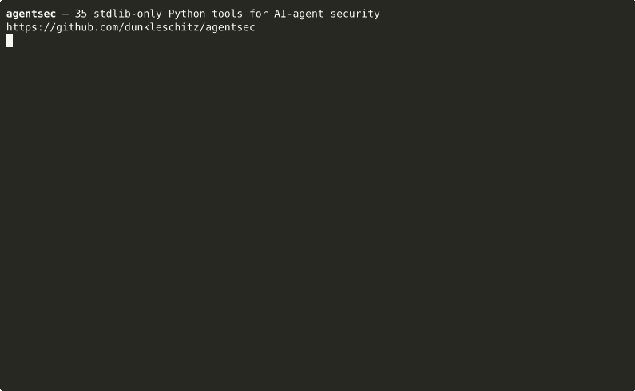

# agentsec

**39 offline, zero-dependency Python tools that scan AI agents for prompt injection, MCP tool poisoning, secret leaks, and other agentic risks.**

[](https://github.com/dunkleschitz/agentsec/actions/workflows/ci.yml)
[](.github/workflows/ci.yml)
[](LICENSE)
[](#install-and-run)



Each tool is a single Python file that uses **only the standard library**. There are no third-party dependencies, no network calls, and no telemetry. Each tool has its own README, examples built from fake data, and a unittest suite. You can run a tool as a standalone script, or install the kit and use the unified `agentsec` command.

> **Status: experimental.** These tools were AI-built (see [How this was built](#how-this-was-built)).
> They are heuristic scanners meant to help a human reviewer. A clean result does not mean
> something is safe.

## Quick start

Python 3.10 or newer is the only requirement. No third-party packages.

Install from this repository (the kit is not on PyPI yet — see [PUBLISHING.md](PUBLISHING.md)):

```sh
pip install git+https://github.com/dunkleschitz/agentsec.git
agentsec --list
agentsec mcpposture ~/.cursor/mcp.json
```

Or clone and run a tool as a standalone script, with no virtualenv and no install:

```sh
git clone https://github.com/dunkleschitz/agentsec.git
cd agentsec/tools/mcpposture
python3 mcpposture.py examples/risky_claude_desktop_config.json
```

When you are ready, point `mcpposture` at your own Cursor, Claude Desktop, or VS Code MCP config. Every tool supports `--help` and `--json`. The same options work after the tool name: `agentsec mcpposture --help`.

```sh
cd agentsec
python3 run_tests.py            # all 39 tool suites plus the unified CLI (or: make test)
python3 run_tests.py toolgate   # one tool
```

## The tools

| Tool | What it does | Try it |
|---|---|---|
| [toolpoison](tools/toolpoison/) | Scans MCP tool manifests for hidden instructions, invisible Unicode, exfil hints, and cross-tool shadowing | `python3 toolpoison.py examples/poisoned.json` |
| [tracesweep](tools/tracesweep/) | Finds secrets that leaked into agent transcripts and logs, with optional masking, JSON, SARIF, or redaction | `python3 examples/make_examples.py && python3 tracesweep.py examples` |
| [runledger](tools/runledger/) | Offline token and cost accounting for agent runs, broken down per run, model, tool, and session | `python3 runledger.py examples/ --budget 0.05` |
| [vibeaudit](tools/vibeaudit/) | Heuristic security-smell scanner for AI-written Python and JS/TS (eval, shell injection, TLS off, and more) | `python3 vibeaudit.py examples --shell` |
| [canarytrap](tools/canarytrap/) | Prompt-injection test harness: feeds canary-tagged payloads to an agent command and checks for leaks | `python3 canarytrap.py run -- python3 examples/naive_agent.py` |
| [mcpposture](tools/mcpposture/) | Least-privilege and supply-chain auditor for MCP client configs, with an A–F grade per server | `python3 mcpposture.py examples/risky_claude_desktop_config.json` |
| [rundiff](tools/rundiff/) | Behavioral diff of two agent runs: added, removed, or reordered tool calls, plus new-surface risk notes | `python3 rundiff.py examples/baseline.jsonl examples/candidate.jsonl` |
| [scopefit](tools/scopefit/) | Least-privilege checker for GitHub tokens used by agents, compared against the REST calls they actually made | `python3 scopefit.py -g examples/classic_overprivileged_scopes.json -c examples/agent_transcript.jsonl` |
| [toolgate](tools/toolgate/) | Policy-as-code for agent tool calls: audit a transcript, or act as a pre-tool-use hook (allow / warn / deny) | `python3 toolgate.py audit examples/risky_transcript.json -p examples/strict_policy.json` |
| [slopcheck](tools/slopcheck/) | Flags hallucinated and slopsquatting-prone package names in AI-generated dependencies and imports | `python3 slopcheck.py examples/risky` |
| [ragsieve](tools/ragsieve/) | Scans documents for indirect prompt injection before they are ingested into a RAG knowledge base | `python3 ragsieve.py examples/poisoned` |
| [yolocheck](tools/yolocheck/) | Grades coding-agent permission and autonomy settings (Claude Code, Codex, Gemini CLI, Copilot, Cursor) | `python3 yolocheck.py examples/risky` |
| [rulesguard](tools/rulesguard/) | Finds rules-file backdoors in agent instruction files (AGENTS.md, CLAUDE.md, `.cursorrules`, and more) | `python3 rulesguard.py examples/risky` |
| [outfence](tools/outfence/) | Scans and sanitizes LLM output before it is rendered (markdown images, dangerous URLs, terminal escapes) | `python3 outfence.py examples` |
| [aibom](tools/aibom/) | AI bill of materials for a repo: SDKs, model IDs, MCP servers, agent files, with a baseline diff for CI | `python3 aibom.py examples/sample_app --baseline examples/baseline.json` |
| [trifecta](tools/trifecta/) | Finds the "lethal trifecta" across an agent's toolset: private data, untrusted content, and exfiltration | `python3 trifecta.py examples/agent` |
| [pickleprobe](tools/pickleprobe/) | Checks pickle-based model files for code-execution risk *without loading them* | `python3 examples/make_examples.py && python3 pickleprobe.py examples/risky` |
| [promptleak](tools/promptleak/) | Detects system-prompt leakage in transcripts and model outputs, including encoded exfil in tool arguments | `python3 promptleak.py examples/leaky_transcript.json` |
| [agentci](tools/agentci/) | Audits GitHub Actions workflows that run AI agents for prompt injection and overly broad permissions | `python3 agentci.py examples/risky` |
| [mcpsink](tools/mcpsink/) | Taint scanner for Python MCP server code: follows tool arguments into shell, paths, URLs, SQL, and eval | `python3 mcpsink.py examples/risky` |
| [agentcard](tools/agentcard/) | Audits A2A Agent Cards with an A–F grade: auth, endpoints, unsigned cards, and injection in skill text | `python3 agentcard.py examples/risky` |
| [loopguard](tools/loopguard/) | Finds runaway loops, retry storms, and mid-call crashes in agent transcripts | `python3 loopguard.py examples/runaway_openai.json` |
| [toolpin](tools/toolpin/) | Pins MCP tool definitions in a hashed lockfile and catches later "rug pulls" and annotation flips | `python3 toolpin.py check examples/drifted.json -l examples/toolpin.lock.json` |
| [resultguard](tools/resultguard/) | Scans *tool results* for indirect prompt injection before those results go back to the model | `python3 resultguard.py examples/poisoned_openai.json` |
| [fetchfence](tools/fetchfence/) | Audits URLs an agent actually fetched for SSRF and destination risk (metadata IPs, `file://`, callbacks) | `python3 fetchfence.py examples/risky_openai.json` |
| [ctxbudget](tools/ctxbudget/) | Checks tool-result size against context-window budgets to catch context stuffing and result floods | `python3 ctxbudget.py examples/risky_openai.json` |
| [modelpin](tools/modelpin/) | Pins expected model IDs and detects floating aliases, mid-run switches, and provider drift | `python3 modelpin.py examples/risky_switch.jsonl -p examples/policy_strict.json` |
| [hitlguard](tools/hitlguard/) | Finds human-in-the-loop gaps: consequential tools that fired without a nearby confirmation | `python3 hitlguard.py examples/risky_openai.json --disable HG08` |
| [pathfence](tools/pathfence/) | Audits file paths an agent touched for sensitive targets (`.env`, SSH keys, cloud creds, `/etc/shadow`) | `python3 pathfence.py examples/risky_openai.json --disable PF12` |
| [shellfence](tools/shellfence/) | Audits shell commands an agent ran for dangerous patterns (`curl\|sh`, `rm -rf /`, reverse shells) | `python3 shellfence.py examples/risky_openai.json --disable SF12` |
| [schemafence](tools/schemafence/) | Audits tool / MCP input schemas for unconstrained high-privilege parameters and annotation contradictions | `python3 schemafence.py examples/risky_mcp.json --disable SK10` |
| [memfence](tools/memfence/) | Scans persistent agent memory / store dumps for poisoning that would re-inject across sessions | `python3 memfence.py examples/poisoned_mem0.json --disable MF10` |
| [tmplfence](tools/tmplfence/) | Scans LLM prompt templates (Jinja2, Mustache, f-strings) for user-controlled variables in system prompts | `python3 tmplfence.py examples/system_prompt.j2 --disable TM10` |
| [piiguard](tools/piiguard/) | Scans transcripts and logs for PII (emails, phones, SSNs, Luhn cards, and more), with `--redact` | `python3 examples/make_examples.py && python3 piiguard.py examples/risky_openai.json --disable PG10` |
| [secretflow](tools/secretflow/) | Tracks secret propagation: a secret-shaped value from a tool result later appearing in another tool's args | `python3 secretflow.py examples/risky_openai.json --disable FL10` |
| [mcpoauth](tools/mcpoauth/) | Audits MCP server OAuth metadata (RFC 9728 / RFC 8414): PKCE S256, implicit/password grants, http endpoints, tokens in URLs, published secrets | `python3 mcpoauth.py examples/risky --resource-url https://mcp.example.com/mcp` |
| [mcpbundle](tools/mcpbundle/) | Audits MCP Bundle (`.mcpb`/`.dxt` manifest.json) and MCP Registry server.json files: inline secrets, non-sensitive credential prompts, pipe-to-shell launches, unpinned packages, privileged containers | `python3 mcpbundle.py examples/risky` |
| [promptaudit](tools/promptaudit/) | Audits system prompts for content that belongs elsewhere: embedded credentials, internal endpoints, authorization logic, unbounded tool authority, PII, disclosed thresholds, hidden Unicode | `python3 promptaudit.py examples/risky_prompt.txt` |
| [tunescan](tools/tunescan/) | Scans fine-tuning datasets (OpenAI chat, Alpaca, ShareGPT, DPO) for backdoor triggers, seeded domains, injected instructions, dangerous commands, and secrets | `python3 tunescan.py examples/poisoned_chat.jsonl` |

Run the "Try it" commands from inside the tool's folder (`cd tools/<name>`). Every tool
supports `--help` and `--json`. Thirty-one tools emit SARIF (`--sarif`): agentcard, agentci, ctxbudget, fetchfence,
hitlguard, loopguard, mcpbundle, mcpoauth, mcpposture, mcpsink, memfence, modelpin, outfence, pathfence,
pickleprobe, piiguard, promptaudit, promptleak, ragsieve, rulesguard, schemafence, secretflow, shellfence,
slopcheck, tmplfence, toolpin, tracesweep, trifecta, tunescan, vibeaudit, and yolocheck.
`--sarif` for resultguard and toolpoison is reserved as a good first issue. Most tools have a `--fail-on` / `--min-severity` switch for CI. Exit codes are
consistent across the kit: `0` means clean, `1` means findings at or above the threshold, and
`2` means a usage or input error.

## Mapping to OWASP

The tables below are a **heuristic mapping** of what each tool helps a reviewer look for. They
are not an official OWASP endorsement, and they do not claim complete coverage of any item.
Sources: [OWASP Top 10 for LLM Applications 2025](https://genai.owasp.org/llm-top-10/) and
[OWASP Top 10 for Agentic Applications 2026](https://genai.owasp.org/resource/owasp-top-10-for-agentic-applications-for-2026/).

### LLM Top 10 (2025)

| Risk | Tools that help a reviewer look for it |
|---|---|
| LLM01 Prompt Injection | toolpoison, canarytrap, ragsieve, rulesguard, resultguard, tmplfence, agentci |
| LLM02 Sensitive Information Disclosure | tracesweep, piiguard, secretflow, pathfence, promptleak |
| LLM03 Supply Chain | slopcheck, aibom, pickleprobe, mcpposture, mcpbundle, toolpin, modelpin |
| LLM04 Data and Model Poisoning | tunescan, ragsieve, memfence |
| LLM05 Improper Output Handling | outfence, vibeaudit, fetchfence, mcpsink |
| LLM06 Excessive Agency | promptaudit, mcpposture, mcpoauth, yolocheck, toolgate, trifecta, scopefit, schemafence, hitlguard |
| LLM07 System Prompt Leakage | promptleak, promptaudit |
| LLM08 Vector and Embedding Weaknesses | ragsieve |
| LLM09 Misinformation | slopcheck (hallucinated / typo-squatted package names) |
| LLM10 Unbounded Consumption | runledger, loopguard, ctxbudget |

### Agentic Top 10 (2026)

| Risk | Tools that help a reviewer look for it |
|---|---|
| ASI01 Agent Goal Hijack | rulesguard, resultguard, canarytrap, agentci |
| ASI02 Tool Misuse and Exploitation | toolgate, trifecta, yolocheck, schemafence, shellfence, pathfence, fetchfence, secretflow |
| ASI03 Identity and Privilege Abuse | scopefit, mcpposture, mcpoauth, pathfence |
| ASI04 Agentic Supply Chain Vulnerabilities | toolpoison, toolpin, mcpposture, mcpbundle, aibom, slopcheck |
| ASI05 Unexpected Code Execution (RCE) | shellfence, pickleprobe, vibeaudit, mcpsink, agentci |
| ASI06 Memory and Context Poisoning | memfence, ragsieve, resultguard, ctxbudget |
| ASI07 Insecure Inter-Agent Communication | agentcard |
| ASI08 Cascading Failures | loopguard, rundiff |
| ASI09 Human-Agent Trust Exploitation | hitlguard |
| ASI10 Rogue Agents | *(no dedicated detector; loopguard, hitlguard, and rundiff can surface related symptoms)* |

`rundiff` and `aibom` are also useful as change detectors (behavioral or inventory drift) rather
than as single-risk scanners. LLM09 is only lightly covered: slopcheck looks at invented
dependency names, not at factual correctness of model output.

## Install and run

Requirements: **Python 3.10 or newer**. No third-party packages are needed.

```sh
pip install git+https://github.com/dunkleschitz/agentsec.git
agentsec --help
agentsec resultguard path/to/transcript.json --json
```

From a clone, `pip install .` (or `pip install -e .`) gives you the same `agentsec` command.
A PyPI release is prepared but not published; the exact steps are in [PUBLISHING.md](PUBLISHING.md).

You can still run any tool as a standalone script with no install:

```sh
git clone https://github.com/dunkleschitz/agentsec.git
cd agentsec/tools/mcpposture
python3 mcpposture.py --help
python3 mcpposture.py ~/.cursor/mcp.json --json
```

Each tool is self-contained. You can copy a single `.py` file (plus any JSON data file next to it,
such as `scopefit_mapping.json`, `slopcheck_known.json` or `prices.json`) onto your `PATH`.

### Run the tests

```sh
python3 run_tests.py            # all 39 tool suites plus the unified CLI (or: make test)
python3 run_tests.py toolgate   # one tool
```

`run_tests.py` runs each suite in its own process. It fails if any suite fails **or runs zero
tests**. CI ([.github/workflows/ci.yml](.github/workflows/ci.yml)) runs the same script on
Python 3.10, 3.11, 3.12 and 3.13 on `ubuntu-latest` for every push and pull request.

## Use in GitHub Actions

Point the reusable composite action at saved transcripts (or MCP configs) in your
repository. It installs this kit and runs the tools you name:

```yaml
name: agentsec
on:
  push:
  pull_request:
permissions:
  contents: read
jobs:
  audit:
    runs-on: ubuntu-latest
    steps:
      - uses: actions/checkout@v4
      - uses: dunkleschitz/agentsec@v0
        with:
          tools: resultguard, secretflow, piiguard, pathfence, shellfence, fetchfence
          paths: agent-runs
          fail-on: high
```

Inputs and outputs are documented in [action.yml](action.yml). Per-tool reports land in
`agentsec-sarif/` (SARIF when the tool supports `--sarif`, otherwise JSON). Pin a release
tag (`@v0` or `@v0.48.0`) once you rely on it; `@main` always tracks the latest commit.

To also gate MCP tool-definition drift, set `mcp-snapshot` and `mcp-lock` and include
`toolpin` in `tools`. The action will run `toolpin check` against those files.

## Guides

Three short writeups live on the site, plus a per-tool reference, a comparison page, an in-browser playground, and a detection benchmark:

- [Prompt injection through tool results](https://dunkleschitz.github.io/agentsec/guides/prompt-injection-through-tool-results/)
- [Pinning MCP tools against drift](https://dunkleschitz.github.io/agentsec/guides/pinning-mcp-tools-against-drift/)
- [A 10-minute security audit for your AI agent](https://dunkleschitz.github.io/agentsec/guides/ten-minute-agent-security-audit/)
- [Tool reference](https://dunkleschitz.github.io/agentsec/tools/) — one page per tool (what it detects, usage, example output, SARIF/CI, OWASP mapping). Regenerated from each tool README by `scripts/generate_tool_pages.py`.
- [Why agentsec](https://dunkleschitz.github.io/agentsec/why/) — a factual comparison with other open-source agent-security scanners.
- [Playground](https://dunkleschitz.github.io/agentsec/playground/) — run resultguard, secretflow, piiguard (`--redact`), mcpposture, and shellfence in the browser with Pyodide. Scanning stays in your tab; no data leaves the browser.
- [Detection benchmark](https://dunkleschitz.github.io/agentsec/benchmarks/) — labeled precision and recall on a small synthetic corpus, with the misses listed on purpose.

## Use with pre-commit

The repository ships [`.pre-commit-hooks.yaml`](.pre-commit-hooks.yaml) so other projects can run selected scanners on commit. Point `rev` at a release tag:

```yaml
repos:
  - repo: https://github.com/dunkleschitz/agentsec
    rev: v0.48.0
    hooks:
      - id: agentsec-secretflow
        files: '(transcripts|agent-runs)/.*\.(json|jsonl)$'
      - id: agentsec-piiguard
        files: '(transcripts|agent-runs)/.*\.(json|jsonl)$'
      - id: agentsec-pathfence
        files: '(transcripts|agent-runs)/.*\.(json|jsonl)$'
      - id: agentsec-shellfence
        files: '(transcripts|agent-runs)/.*\.(json|jsonl)$'
      - id: agentsec-resultguard
        files: '(transcripts|agent-runs)/.*\.(json|jsonl)$'
      - id: agentsec-mcpposture
      - id: agentsec-rulesguard
      - id: agentsec-toolpin
        args: ["--fail-on", "high", "-l", "toolpin.lock.json"]
        files: 'mcp-tools-snapshot\.json$'
```

Available hook ids: `agentsec-secretflow`, `agentsec-piiguard`, `agentsec-toolpin`, `agentsec-pathfence`, `agentsec-shellfence`, `agentsec-resultguard`, `agentsec-fetchfence`, `agentsec-tracesweep`, `agentsec-mcpposture`, `agentsec-rulesguard`, `agentsec-promptleak`, `agentsec-hitlguard`, `agentsec-memfence`, `agentsec-tmplfence`, and `agentsec-schemafence`.

Default `files:` filters are conservative but still worth narrowing to the directories where you store transcripts or configs. Most hooks pass `--fail-on high` so info and low findings do not block a commit. `agentsec-toolpin` runs `toolpin check`; you must pass the lockfile with `args` and limit `files` to the snapshot you want checked.

These are the same heuristic scanners as the CLI. A clean hook is not a security boundary.

## Run with Docker

A non-root `python:3.12-slim` image is published to the GitHub Container Registry on pushes to `main` and on version tags:

```sh
# Scan a local file. Mount the directory read-only; the process runs as uid 1000.
docker run --rm -v "$PWD:/work:ro" ghcr.io/dunkleschitz/agentsec:v0.48.0 \
  mcpposture /work/mcp.json

docker run --rm -v "$PWD:/work:ro" ghcr.io/dunkleschitz/agentsec:v0.48.0 \
  resultguard /work/transcript.json --json --fail-on high
```

Tags: `v0.48.0` (this release), `v0` (floating major, follows the latest `v0.x` tag), and `latest` (the tip of `main`). The image `ENTRYPOINT` is `agentsec`; arguments after the image name are passed to the CLI. The first pull from `ghcr.io` on a public repository may require the package to be set public in GitHub → Packages if a fresh publish created it as private.

Build a local copy from a clone with `docker build -t ghcr.io/dunkleschitz/agentsec:local .`. The workflow at [`.github/workflows/docker.yml`](.github/workflows/docker.yml) authenticates to `ghcr.io` with `GITHUB_TOKEN`.

## Framework examples

[`examples/frameworks/`](examples/frameworks/) has short, stdlib-only demos that run agentsec on fake exports from LangChain, the OpenAI Agents SDK, CrewAI, and Cursor / Claude Desktop MCP configs. No framework packages are installed. Transcript-style dumps are rewritten into the OpenAI-shaped messages the tools already parse:

```sh
python3 examples/frameworks/run_demo.py
python3 examples/frameworks/normalize.py examples/frameworks/langchain/export.json -o /tmp/transcript.json
python3 -m agentsec resultguard /tmp/transcript.json --fail-on high
```

MCP client configs are handed to `mcpposture` directly. Every secret in the fixtures is fake.

## How this was built

- **AI-built.** The tools, tests and documentation were written by an AI coding agent working
  through a series of build sessions, one tool at a time. A human chose the direction and
  reviewed the result before release. Treat the code as you would any new, lightly reviewed
  open-source project: read it before relying on it.
- **What it was tested against.** Each tool ships with a unittest suite (2136 tests in total)
  and with example inputs built from **synthetic, fake data**: fake keys, fake transcripts,
  fake configs and fake documents. The tests check rule behavior, output formats and CLI exit
  codes against those fixtures. A small labeled corpus in [`benchmarks/`](benchmarks/)
  reports per-tool precision and recall, a before/after table on the original 85-sample corpus, a held-out set, and eight independent red-team rounds. The latest independent unseen score is round 8 (100 samples, written against the frozen v0.47.0 detectors by a separate author who did not read tool source, tests, or prior fixtures): P=95.6% R=66.2% F1=78.2% (43/2/22/33). That frozen number stays the headline independent score. After the v0.48.0 class-level generalization the same set is **seen** at P=100.0% R=93.8% F1=96.8% (61/0/4/35). Round 7 remains an unseen score on the v0.47.0 rules (80 samples): P=100.0% R=92.5% F1=96.1% (49/0/4/27). Unseen F1 across successive independent rounds has been 78.3 (round 3) → 74.4 (round 4) → 61.5 (round 5) → 81.3 (round 6) → 96.1 (round 7) → 78.2 (round 8). Round 6 is now seen at P/R/F1 100% (53/0/0/27) on the same 80 samples; its original unseen score stays visible at P=97.4% R=69.8% F1=81.3%. Round 5 seen is also 100% (53/0/0/27); its original unseen score stays visible at P=96.0% R=45.3% F1=61.5%. The results page lists
  every false negative and false positive. The tools have **not** been benchmarked against
  real-world corpora, real attack datasets, or the live schemas of every agent or MCP client
  they parse.
- **Known limits.**
  - *Observed versus inferred.* Tools that read transcripts (tracesweep, runledger, rundiff,
    scopefit, toolgate, promptleak) only see what was logged. They cannot see runtime side effects, real
    token scopes or unlogged calls. Some results are inferences: for example, scopefit maps
    endpoints to permissions using a best-effort subset of the GitHub docs, and slopcheck
    compares names with a bundled snapshot rather than the live registry. The tool READMEs say
    which outputs are observed and which are inferred, and unknown cases are reported as
    unmapped rather than guessed.
  - *Heuristics produce false positives and false negatives.* Most detectors are regex, AST or
    pattern based. Determined attackers can evade them, and benign text sometimes matches
    them. Use them as review aids and CI tripwires, not as a security boundary.
  - *Formats drift.* Config and transcript formats for agent tools change often. Parsers are
    best-effort as of 2026, and unrecognized shapes are reported (as `info`) rather than
    silently passed.
  - canarytrap is a smoke test. An agent "resisting" its payloads is not proof that the agent is
    robust to prompt injection.

## Repository layout

```
agentsec/
├── agentsec/            unified CLI package (`pip install .` → `agentsec <tool>`)
├── tools/<name>/        one folder per tool: <name>.py, README.md, tests/, examples/
├── docs/                GitHub Pages site (/tools/, /guides/, /why/, /playground/, /benchmarks/)
├── examples/frameworks/ stdlib-only demos for LangChain, OpenAI Agents, CrewAI, MCP clients
├── benchmarks/          labeled synthetic corpus and precision/recall runner
├── tests/               tests for the unified CLI, Action, pages generator, hooks, and examples
├── scripts/             Action runner, generate_tool_pages.py, sync_playground.py
├── action.yml           reusable composite Action (`uses: dunkleschitz/agentsec@v0`)
├── Dockerfile           non-root python:3.12-slim image (ghcr.io/dunkleschitz/agentsec)
├── .pre-commit-hooks.yaml
├── pyproject.toml       packaging (stdlib-only; no publish until you follow PUBLISHING.md)
├── run_tests.py         runs every suite, enforces the zero-test rule
├── Makefile             `make test`, `make pages`, `make playground`, `make benchmark`
├── .github/workflows/   CI, Action self-test, GHCR publish, and a manual-only PyPI publish workflow
├── CODE_OF_CONDUCT.md   CONTRIBUTING.md   SECURITY.md   LICENSE   PUBLISHING.md
```

## License

MIT, see [LICENSE](LICENSE). All example secrets in this repository are fake.

See also: [Contributing](CONTRIBUTING.md), [Security policy](SECURITY.md), and the
[Code of Conduct](CODE_OF_CONDUCT.md).
